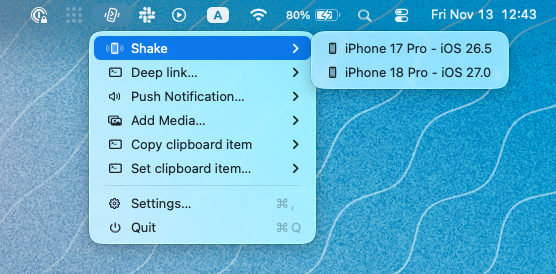
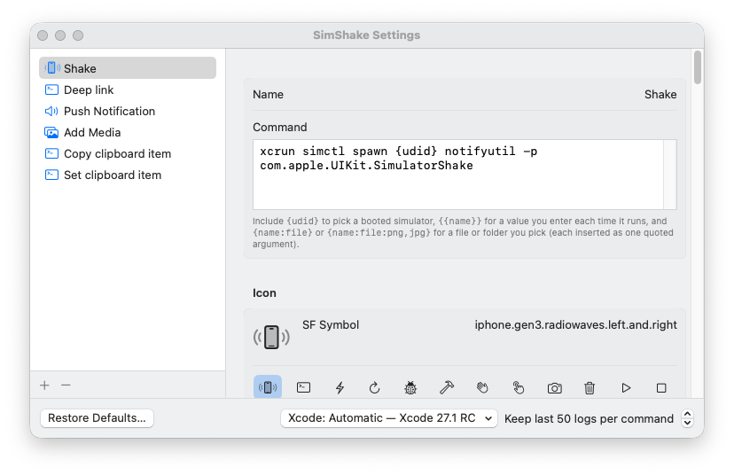

<p align="center">
  <picture>
    <source media="(prefers-color-scheme: dark)" srcset="Support/Icon-dark.svg">
    
  </picture>
</p>

<h1 align="center">SimShake</h1>

<p align="center">A macOS menu bar app for running commands against iOS simulators.</p>

<p align="center">
  
</p>

It ships with four default commands:

| Command | What it does |
|---|---|
| **Shake** | Sends the shake gesture to a booted simulator. |
| **Deep Link** | Opens a URL you enter. |
| **Push Notification** | Sends an `.apns` or `.json` payload file you pick to the bundle ID you enter. |
| **Add Media** | Imports a photo or video you pick into the simulator's Photos library. |

**Requirements:** macOS 13+, Swift 6, and Xcode for simulator commands. `xcode-select` can stay
pointed at the Command Line Tools; SimShake finds Xcode itself (see [Xcode](#xcode)).

## Install

```sh
./build.sh
```

Builds a release binary, assembles and ad-hoc signs `build/SimShake.app`, quits any running copy,
installs it to `~/Applications/SimShake.app`, and launches it. Run it again to update.

On first launch from `~/Applications` (or `/Applications`), SimShake adds itself to your login
items; manage this in **System Settings → General → Login Items**.

## Commands

Open **Settings…** from the menu bar icon to add, edit, reorder, or delete commands and pick their
icons. **Restore Defaults** replaces all commands with the four defaults.

<p align="center">
  
</p>

<details>
<summary>Upgrading from an older install</summary>

Installs from before Deep Link, Push Notification, or Add Media existed get each one appended to
their list once, unless a command with the same name (case-insensitive) or the same command text
already exists. Delete one and it stays deleted.
</details>

Commands run through your login shell (`$SHELL -l -c "<command>"`), so `PATH` from `~/.zprofile`
(e.g. Homebrew) applies. `~/.zshrc` is not loaded, so tools set up only there (such as nvm) need
full paths.

### Placeholders

| Placeholder | Replaced with | Example |
|---|---|---|
| `{udid}` | The target simulator's UDID | `xcrun simctl openurl {udid} https://example.com` |
| `{{name}}` | A value you enter each run | `say {{text}}` |
| `{name:file}` | A file or folder you pick each run | `xcrun simctl install {udid} {app:file:app}` |
| `{name:file:ext1,ext2}` | Same, limited to those extensions | `xcrun simctl addmedia {udid} {media:file:png,jpg,jpeg,heic,gif,mp4,mov,m4v}` |

More examples:

```sh
xcrun simctl spawn {udid} notifyutil -p com.apple.UIKit.SimulatorShake
xcrun simctl openurl {udid} {{url}}
```

- **`{udid}`:** with several simulators booted, the command opens a submenu to pick one; with
  exactly one, it runs on it directly; with none, it is greyed out.
- **`{{name}}` and `{name:file}`:** the command shows `…` in the menu and opens a dialog with one
  required field per parameter. File fields have a **Choose…** button, but you can also type or
  paste a path (a leading `~` is expanded). Reusing a name asks once and inserts the value
  everywhere.
- Every value is inserted as one shell-quoted argument, so write placeholders without quotes.

### Running

Commands without `{udid}` run directly when clicked. Success is silent; a non-zero exit shows a
notification with the end of the output. Commands still running when SimShake quits are stopped.

## Xcode

Each time SimShake lists simulators or runs a command, it picks an Xcode and passes it as
`DEVELOPER_DIR`, so `xcrun simctl` works without `sudo xcode-select -s`. The same `DEVELOPER_DIR`
applies to your commands, so `xcrun` in them uses that Xcode too.

**Automatic** (the default) uses, in order:

1. the `xcode-select -p` directory, if it contains `usr/bin/simctl` (the Command Line Tools don't);
2. otherwise the best Xcode at the top level of `/Applications` or `~/Applications`: stable before
   pre-release, then highest version, then highest build.

If no Xcode is found, simulator commands are greyed out with a tooltip explaining why.

The **Xcode** pop-up at the bottom of **Settings…** shows what Automatic resolves to, lists the
Xcodes found, and has **Choose…** to pin any other Xcode. A pinned Xcode is used until you switch
back to Automatic; if it's deleted or moved, SimShake falls back to Automatic and the pop-up shows
a warning. **Restore Defaults** doesn't change this choice.

<details>
<summary>Edge cases</summary>

- A `DEVELOPER_DIR` exported in `~/.zprofile` wins for commands, since the login shell sets it
  after SimShake does.
- Xcode bundles don't mark pre-releases, so they're recognised by app name: `beta` means beta;
  `Release Candidate` or a standalone `RC` means release candidate (matching the Xcodes app's
  naming, e.g. `Xcode-27.1.0-Release.Candidate.app`). A pre-release renamed to `Xcode.app`
  counts as stable.
</details>

## Logs

Every run writes a log to `~/Library/Logs/SimShake/<command-id>/`, named after its start time
(e.g. `2026-10-02_14-03-27-512.log`).

<details>
<summary>Log file layout</summary>

1. **Header:** the action, the command as it ran (with `{udid}` and parameters filled in), the
   simulator if any, and the start time.
2. **Output:** written as it arrives.
3. **Footer:** the end time and exit status, or a note that the run was stopped because SimShake
   quit.
</details>

Each command's page in **Settings…** has a **Logs** section listing its runs, newest first, with
status (finished, failed, running, stopped, or incomplete if SimShake exited before writing the
footer), simulator, start time, and command. Click a run to open it. **Show in Finder** opens the
command's log folder; **Clear…** deletes all its logs.

**Keep last N logs per command** (default 50) sets retention. Older logs are pruned the next time
that command runs, so lowering it doesn't delete anything immediately. Removing a command, or
**Restore Defaults**, deletes the removed commands' logs.

## Development

```sh
swift test
```

The menu bar and app icons are rendered from `Support/Icon.svg` by `Support/make-icons.swift`
during the build; replace the SVG to change both. `Support/Icon-dark.svg` is a white copy used
only by this README for GitHub's dark theme.
